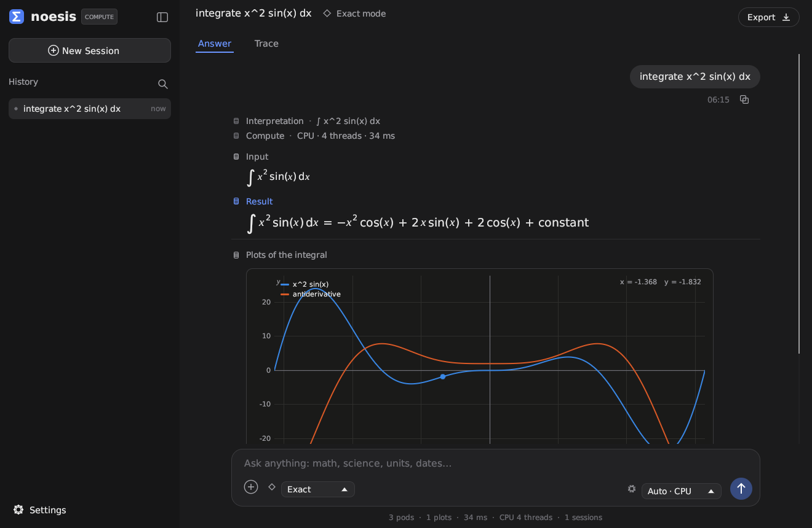
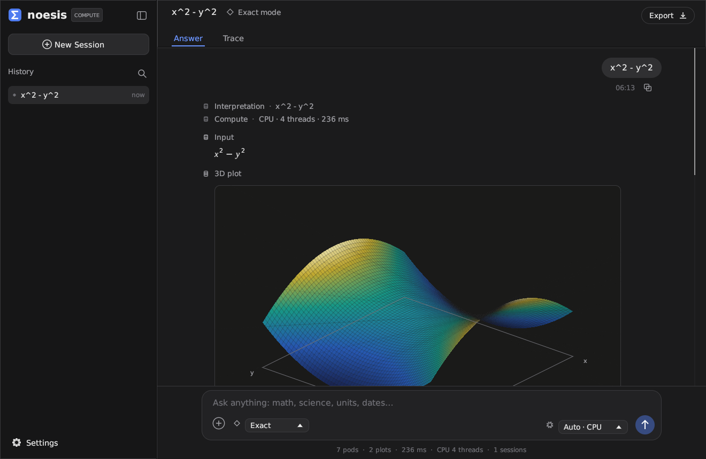
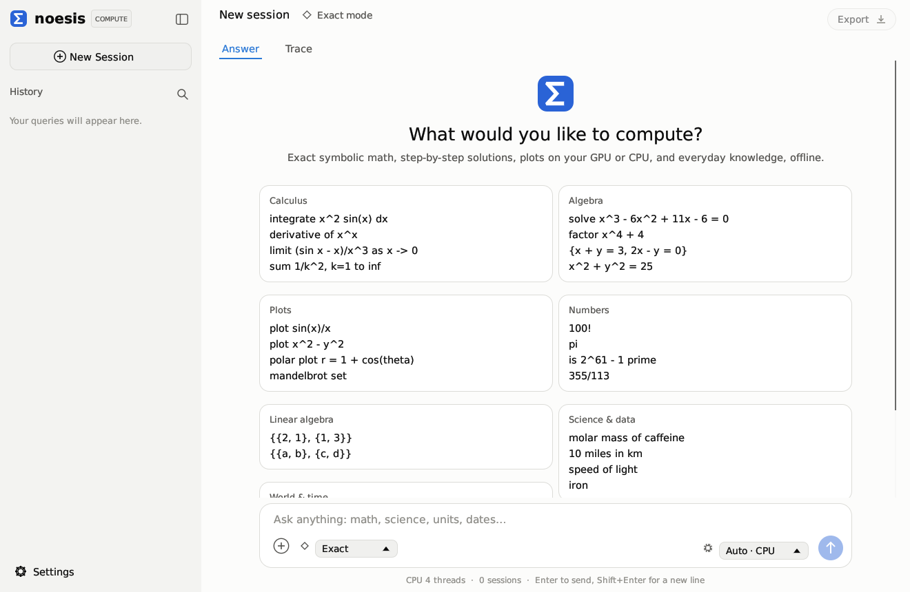

# Noesis

**An open-source computational knowledge engine, written in Rust, that runs offline on your CPU and GPU.**

Type a calculation, an equation, a function, a question in plain English or a unit conversion, and Noesis answers the way WolframAlpha does: with a stack of result *pods*. These include the interpreted input, an exact result, decimal approximations, alternate forms, roots, plots, derivatives, integrals, series and step-by-step working. It is a desktop app for Linux and Windows, and a command-line tool.



| 3-D surface, rotatable | Welcome screen (light theme) |
| --- | --- |
|  |  |

## What it can do

| Area | Examples |
| --- | --- |
| Arithmetic and numbers | `2^100`, `100!`, `355/113`, `pi` to 50 digits, `(1+2i)^3`, number names, prime factorization, divisors, bases, Roman numerals, continued fractions |
| Algebra | `factor x^4 + 4`, `expand (x+1)^5`, `partial fractions 1/(x^2-1)`, `simplify sqrt(3 + 2 sqrt(2))`, alternate forms |
| Equations | `solve x^3 - 6x^2 + 11x - 6 = 0`, `sin(x) = 1/2` (general solution with n ∈ ℤ), `e^(2x) - 3e^x + 2 = 0`, radical and absolute-value equations, Cardano formulas, numeric roots |
| Systems and inequalities | `{x^2 + y^2 = 25, x + y = 7}`, `{2x + 3y - z = 1, …}`, `(x-1)/(x+2) >= 0` → `x < -2 or x ≥ 1` with a number line |
| Calculus | `derivative of x^x` (with steps), `integrate x^2 sin(x) dx` (with steps), `integrate e^(-x^2) from -inf to inf`, `limit (sin x - x)/x^3 as x -> 0`, `taylor series of e^x`, `sum 1/k^2, k=1 to inf`, `product k, k=1 to n` |
| Differential equations | `y'' + y = 0`, `y' = x y`, `dy/dx = x/y`, `y'' - 3y' + 2y = e^x`, `y'' + 4y = sin(x), y(0)=0, y'(0)=1`: classification, general solution, solution of the initial value problem, solution families; Runge–Kutta numeric solutions when there is no closed form |
| Integral transforms | `laplace transform of t^2 e^t`, `laplace transform of e^(-2t) cos(t)`, `inverse laplace of (s+1)/(s^2+2s+5)` |
| Function analysis | any `f(x)`: plot, roots, domain, range, parity, period, derivative, antiderivative, global extrema, limits at ±∞, series |
| Two variables | `x^2 - y^2`: 3-D surface, contour plot, partial derivatives, critical points with classification; `x^2 + y^2 = 25`: implicit plot, conic classification, implicit derivative |
| Linear algebra | `{{1,2},{3,4}}`: determinant, inverse, eigenvalues and eigenvectors, characteristic polynomial, rank, row-reduced form, null space, singular values; works with symbolic entries |
| Statistics and probability | `mean of 3, 7, 7, 19, 24`, data lists (summary, histogram), `linear fit {{1,2},{2,4.1},…}`, `normal distribution mean 100 sd 15 P(X > 130)`, `probability of 3 heads in 5 coin flips`, combinatorics |
| Plots | `plot sin(x) and cos(x)`, `plot x^2 + y^2 = 4`, `polar plot r = 1 + cos(theta)`, `parametric plot (cos 3t, sin 2t)`, `mandelbrot set`, `julia set c = -0.8+0.156i` |
| Units and constants | `10 miles in km`, `100 km/h to mph`, `32 F to C`, `5 ft 3 in to cm`, `1 GiB in bytes`, `how many feet in a mile`, `speed of light`, `planck constant` |
| Chemistry | `iron`, `boiling point of mercury`, `molar mass of caffeine`, `molar mass of CuSO4·5H2O`, `H2SO4` (composition and mass fractions) |
| Geography and time | `france`, `population of japan`, `tokyo`, `distance from Paris to London`, `time in Sydney` |
| Dates and money | `what day was July 4, 1776`, `days until christmas`, `100 days from today`, `compound interest $1000 at 5% for 10 years compounded monthly`, `mortgage $300000 at 6.5% for 30 years`, `15% tip on $80` |
| Logic | `p and q or not p`: truth table, satisfiability, normal form |

## How it compares with WolframAlpha

Noesis reproduces WolframAlpha's style of answer, pods with exact and approximate results, alternate forms, plots and steps, and it covers the core of its mathematics. It goes further in a few ways:

* It runs **entirely offline** on your machine. Your queries never leave it.
* It is **open source** (MIT) and scriptable from the command line, with JSON output.
* Plot and grid work runs on your **GPU** through wgpu (Vulkan, Metal, DirectX 12 or OpenGL), with an automatic fallback to all CPU cores.
* Plots are **interactive**: pan, zoom with live re-sampling, and rotatable 3-D surfaces.

It is also more limited, and these limits are real:

* **No curated live data.** WolframAlpha draws on a vast, continuously updated knowledge base: weather, finance, nutrition, people, films, sports. Noesis ships a small offline dataset (118 elements, about 250 countries, about 6,000 cities and a few dozen physical constants). Population figures come from GeoNames and are not live.
* **Narrower language understanding.** Noesis recognises the phrasings listed above and ordinary mathematical notation. It does not understand arbitrary English questions.
* **A smaller computer algebra system.** Integration is heuristic: tables, substitution, parts, rational functions, Euler and Weierstrass substitutions and special functions (erf, Si, Ei, Fresnel). It is not a complete Risch implementation, so some elementary integrals that Mathematica finds will be missed. Every antiderivative is checked numerically before it is shown, so wrong answers are rejected rather than displayed. Factoring is over ℚ only, and high-degree polynomials fall back to numeric roots.
* **Step-by-step solutions** cover derivatives, integrals (substitution, integration by parts, partial fractions, trigonometric identities and so on) and quadratic equations. Limits, sums and general equations do not have worked steps yet.
* **Differential equations:** linear equations with constant coefficients of any order, and first-order linear, separable and Bernoulli equations. Other nonlinear and variable-coefficient higher-order equations get a numeric solution when initial conditions are given. Partial differential equations are not supported.
* **Precision:** decimals are arbitrary-precision for elementary constants (50 digits shown). Special functions and GPU evaluation use double and single precision respectively.

## Install and run

### Build from source

You need a Rust toolchain, version 1.89 or newer, from [rustup.rs](https://rustup.rs).

```bash
cargo build --release
```

```bash
./target/release/noesis
```

`noesis` with no arguments opens the desktop app. `noesis-desktop` is the same app without a console window on Windows.

**Linux:** the app uses X11 or Wayland through OpenGL. Most desktops already have the libraries it needs. On minimal systems install `libxkbcommon-x11-0`, `libgl1` and `libegl1`, plus a Vulkan driver if you want GPU compute.

**Windows:** build natively with the MSVC toolchain, or cross-compile from Linux with `rustup target add x86_64-pc-windows-gnu` and MinGW (`gcc-mingw-w64-x86-64`).

### Command line

```bash
noesis "integrate x^2 sin(x) dx"
```

```bash
noesis --short "solve x^3 - 6x^2 + 11x - 6 = 0"
```

```bash
noesis --json "molar mass of caffeine"
```

```bash
noesis --svg plots "plot sin(x)/x"
```

```bash
noesis --repl
```

Options: `--json`, `--short`, `--device auto|cpu|gpu`, `--digits N`, `--timeout S`, `--no-steps`, `--svg DIR`, `--benchmark`, `--devices`. See `noesis --help`.

### As a library

```rust
let result = noesis::query("derivative of x^3 ln(x)");
println!("{}", result.short_answer().unwrap());
// d/dx(x^3 log(x)) = x^2 (3 log(x) + 1)
```

The engine crate (`crates/engine`, imported as `noesis`) has no GUI dependencies. Build it with `--no-default-features` to leave out GPU support.

## The desktop app

The interface follows the layout of modern agent workbenches:

* a sidebar of past sessions, with search and a **New Session** button;
* a header with the session title, the mode (exact, approximate or step-by-step), **Answer** and **Trace** tabs, and **Export**;
* the result stream: your query in a bubble, then the interpretation, the compute device and timing, and the pods;
* a composer with an examples menu, a mode selector, a compute-device selector (Auto, CPU or GPU) and a send button, with a stats line underneath.

Math is typeset (fractions, radicals, sums, integrals, matrices). Plots can be panned, zoomed (curves are re-sampled) and rotated (3-D). Results export to Markdown, JSON or SVG. The app has dark and light themes and keeps your history across launches.

Keyboard shortcuts: **Enter** sends, **Shift+Enter** inserts a new line, **Ctrl+N** starts a new session, **Ctrl+B** toggles the sidebar.

## GPU and CPU

Dense numeric work goes through `noesis::compute`: curve sampling, surface and contour grids, implicit curves, fractals and Monte Carlo. Expressions are compiled to a small stack-machine program, which is either:

* run on every CPU core with rayon, or
* translated to a **WGSL compute shader** and run through **wgpu** on Vulkan, Metal, DirectX 12 or OpenGL.

The GPU path works in `f32` and covers the elementary functions plus gamma, erf and sinc. Anything else, or any failure to find an adapter, falls back to the CPU automatically. Software rasterisers are skipped by default, since the CPU path is faster on the same hardware. Set `NOESIS_ALLOW_SOFTWARE_GPU=1` to force them, or `NOESIS_NO_GPU=1` to disable the GPU.

`noesis --benchmark` reports evaluations per second on each device.

The GPU kernels have been validated against the CPU results on a Vulkan adapter (Mesa lavapipe), with relative error around 10⁻⁶ as expected for `f32`. They have **not yet been run on discrete GPU hardware** by the authors. Reports are welcome.

## Architecture

```
crates/engine  (library "noesis")
  expr, funcs        expression tree with auto-simplifying constructors
  parse, print       input parser (implicit multiplication, sin^2 x, |x|, 3 1/2, …),
                     plain text / typeset tree / LaTeX output
  poly, simplify     dense and sparse polynomials, gcd, factoring over ℚ,
                     rational functions, simplification by rewrite search
  calculus           derivatives (with steps), Puiseux/Laurent series, limits,
                     integration, definite integrals, sums and products, ODEs
  solve              polynomial roots, inversion, periodic solutions, systems,
                     resultants, inequalities
  linalg, stats      matrices (exact/symbolic), statistics, distributions, fits
  numeric, special   quadrature, root finding, ODEs, special functions
  bigfloat           arbitrary-precision decimals (astro-float)
  eval, compute, gpu stack-machine evaluator, CPU/GPU dispatch, WGSL kernels
  plot               sampling, implicit curves, surfaces, SVG export
  engine             query cleaning, handler registry, analyzer, pods (parallel)
  domains            units and constants, chemistry, geography, dates, finance,
                     probability
crates/app  (binaries "noesis" and "noesis-desktop")
  cli                terminal interface
  gui                egui/eframe desktop app
```

Every query runs on its own large-stack thread with a time budget. Each pod is computed in parallel with its own share of that budget, so one slow computation cannot hold up the rest of the answer.

## Tests

```bash
cargo test -p noesis-engine --no-default-features
```

The suite covers parsing, simplification, factoring, calculus, solving, number theory, high-precision decimals and end-to-end queries across every domain. Set `NOESIS_DEBUG=1` to see panic messages from failing tests. The engine silences panics by default because it uses them for timeouts.

## Data sources

* Countries and cities: [GeoNames](https://www.geonames.org), licensed CC BY 4.0, via the `geonamescache` package.
* Chemical elements: the [`mendeleev`](https://github.com/lmmentel/mendeleev) package, MIT licensed.
* Physical constants: CODATA 2018 recommended values.
* Fonts: DejaVu (Bitstream Vera licence, public-domain changes) and Liberation Serif (SIL Open Font License 1.1). Licence texts are in `crates/app/assets/fonts/`.

`tools/build_data.py` regenerates the bundled JSON files.

## License

MIT. See [LICENSE](LICENSE).
